# OpenWay · Freedom to move

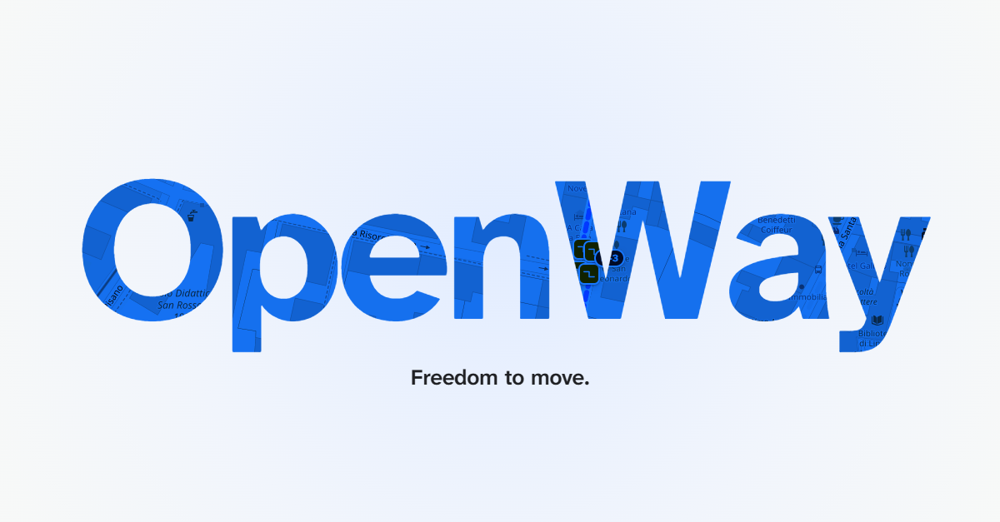

OpenWay è un prototipo per orientarsi in sedia a rotelle nella zona universitaria di Pisa, nato all'Hacktoberfest del GDG Pisa (ottobre 2026), dove si è classificato secondo come miglior progetto open source. Calcola un percorso, lo confronta con i dati di OpenStreetMap e con le segnalazioni degli utenti, e dice in chiaro cosa si sa, cosa è solo probabile e cosa manca. Non definisce mai un percorso «accessibile» o «sicuro».

- **Landing page:** https://gixrda.github.io/openway/
- **Codice dell'app e della landing:** https://github.com/gixrda/openway
- **Bozza del post LinkedIn:** [POST_LINKEDIN.md](POST_LINKEDIN.md)

Questo repository raccoglie immagini e testi per presentare il progetto. Il codice vive nel repository `openway`.

## La landing

| | |
|---|---|
| 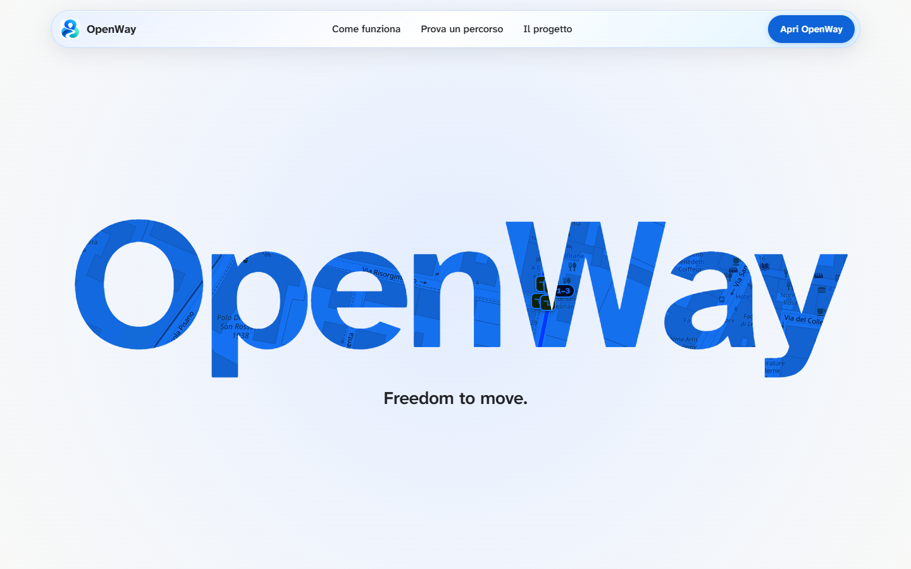 | 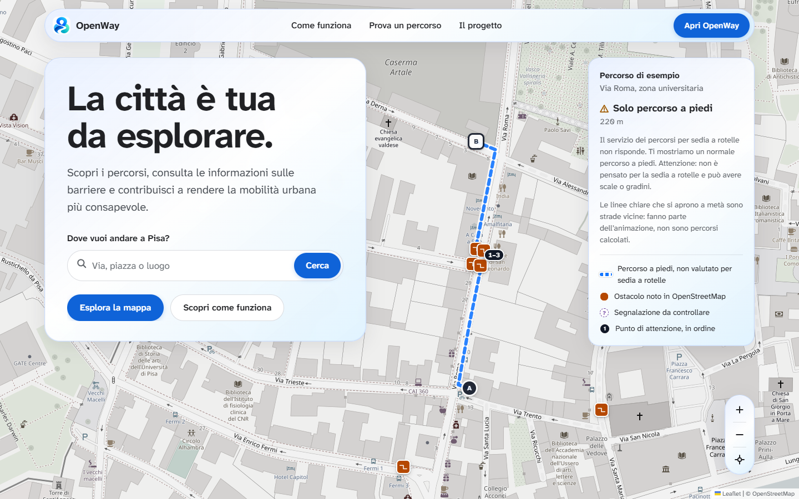 |
| L'apertura: la mappa reale di Pisa si vede attraverso le lettere. Scorrendo, il nome si apre e lascia spazio alla mappa. | La hero: ricerca, percorso di esempio con i punti di attenzione numerati, scheda con i limiti dei dati. |
| 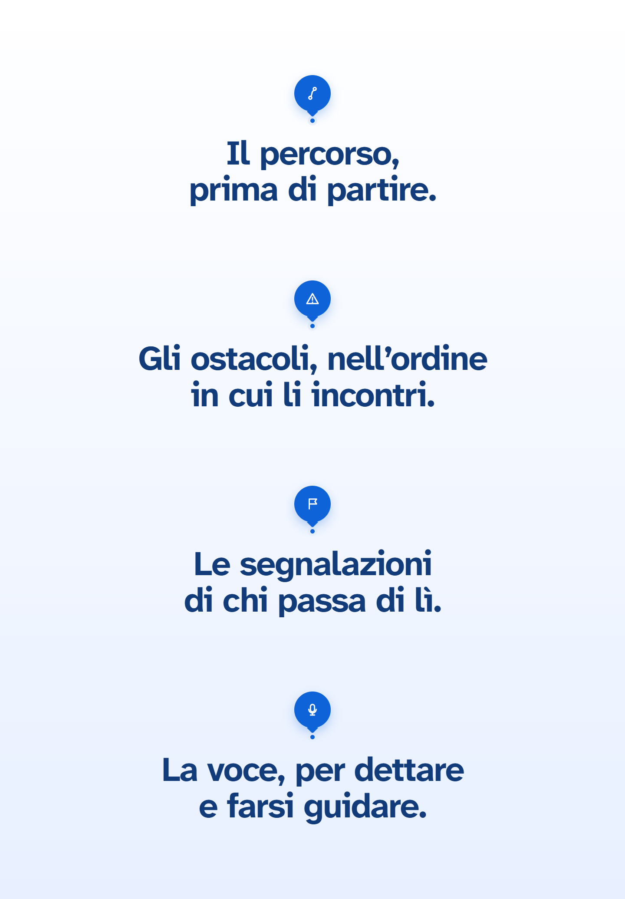 | 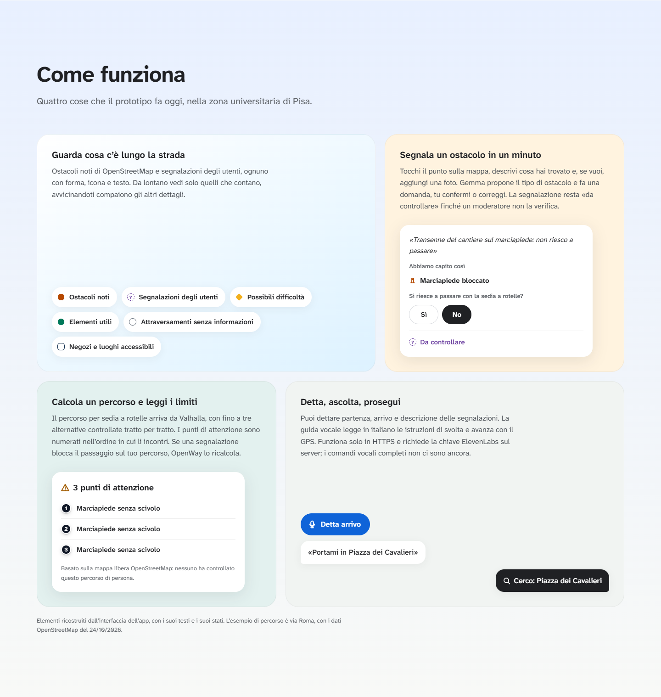 |
| In breve: quattro icone a goccia, una per funzione. | Come funziona: piccole interfacce ricostruite con i testi e gli stati veri dell'app. |
| 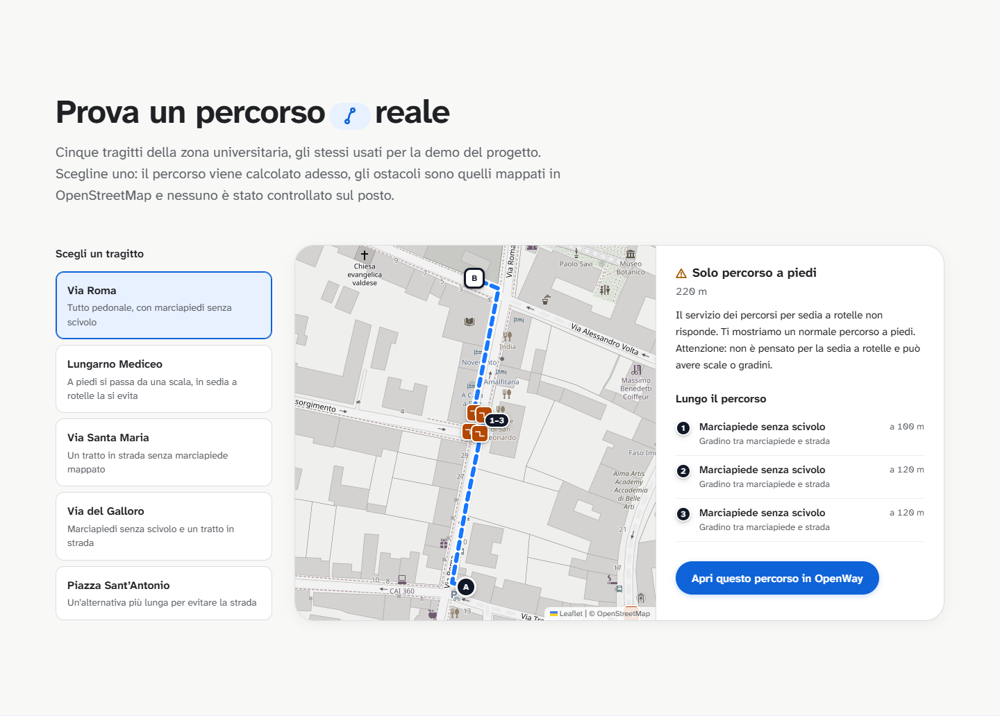 |  |
| La demo: i cinque tragitti usati per presentare il progetto. | Più informazioni, meno incertezza. |
| 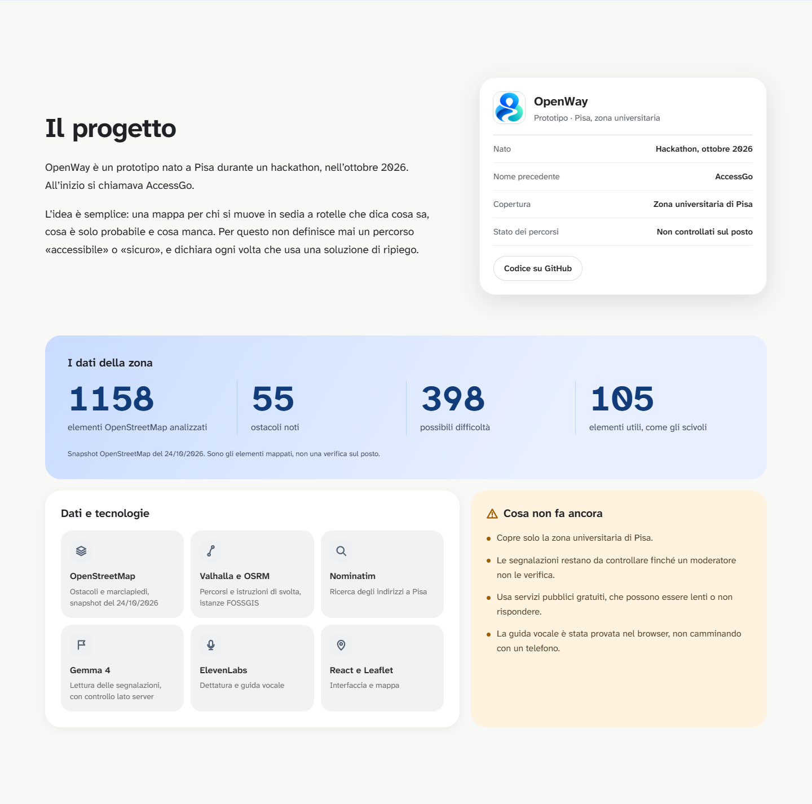 | 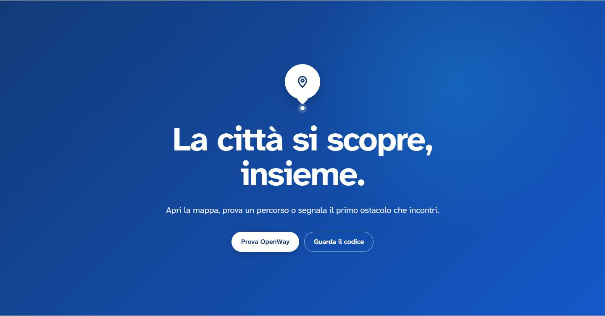 |
| Il progetto: dati OpenStreetMap della zona, tecnologie, cosa non fa ancora. | La chiusura. |

  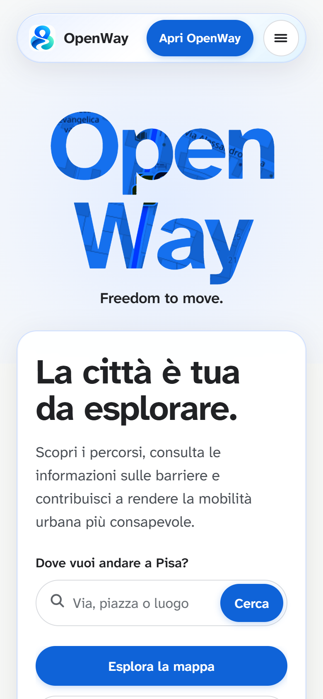
  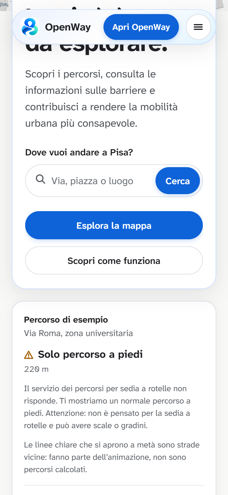

## The Living Line

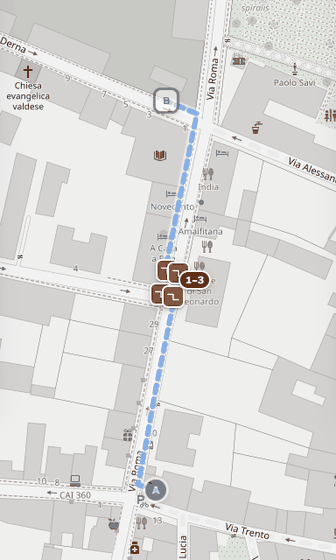

La linea della hero percorre la geometria reale del percorso. A un incrocio si aprono per un attimo le strade vicine, prese da OpenStreetMap, poi la linea arriva a destinazione e ricomincia. Le diramazioni sono solo animazione e la pagina lo dice. Se tocchi la mappa l'animazione si ferma; con «riduci movimento» attivo il percorso resta fermo.

## Come è fatta

- **Interfaccia:** React, Leaflet, GSAP e Motion; carattere Atkinson Hyperlegible Next.
- **Dati:** snapshot OpenStreetMap del 24/10/2026, 1158 elementi della zona universitaria.
- **Percorsi:** Valhalla con profilo per sedia a rotelle, OSRM come ripiego dichiarato.
- **Segnalazioni:** Gemma 4 legge la descrizione e fa una domanda; chi segnala conferma o corregge.
- **Voce:** dettatura e guida vocale con ElevenLabs.

La landing pubblicata su GitHub Pages è statica: i percorsi della demo sono registrati con la data. Quando sono stati registrati il servizio Valhalla non rispondeva, quindi la pagina mostra il percorso a piedi di ripiego e lo dichiara.

## Limiti dichiarati

- Copre solo la zona universitaria di Pisa.
- Nessun percorso è stato controllato di persona.
- Le segnalazioni restano «da controllare» finché un moderatore non le verifica.
- Usa servizi pubblici gratuiti, che possono essere lenti o non rispondere.

## Sicurezza

Le chiavi restano sul server e non sono nel repository; il sito pubblicato ha una Content Security Policy e parla solo con le tile di OpenStreetMap e con Nominatim. Dettagli e segnalazioni di vulnerabilità: [SECURITY.md del progetto](https://github.com/gixrda/openway/blob/main/SECURITY.md).

## Crediti

Mappe e dati © [OpenStreetMap contributors](https://www.openstreetmap.org/copyright) (ODbL). Percorsi: Valhalla e OSRM (FOSSGIS e.V.). Ricerca: Nominatim. Carattere: Atkinson Hyperlegible Next (Braille Institute, OFL). Le immagini di questo repository sono schermate della landing.
